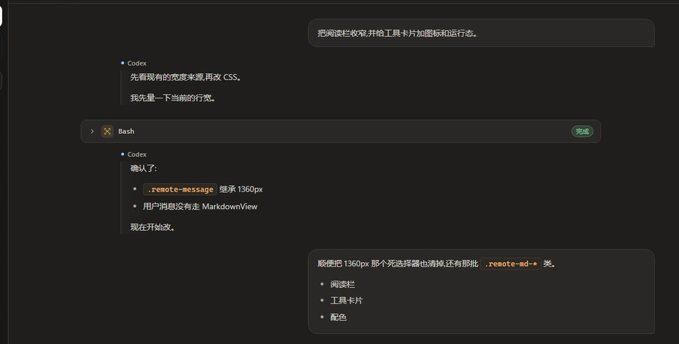

# AgentHub

> **The Unified Remote Continuation & Control Plane for Official AI Agents**  
> Continue **Antigravity (`agy`)**, **OpenAI Codex**, **Claude Desktop**, **Claude Code**, **DeepSeek Harness**, and dynamically installed **ACP Plugins** from any browser, mobile PWA, or Android client.

<p align="center">
  <a href="README.md"><b>English</b></a> •
  <a href="README_CN.md">简体中文</a> •
  <a href="docs/README.md">Documentation</a> •
  <a href="docs/ARCHITECTURE.md">Architecture</a> •
  <a href="docs/CHANGELOG.md">Changelog</a>
</p>

<p align="center">
  <a href="https://github.com/xiaoran7/agenthub/releases"></a>
  <a href="https://github.com/xiaoran7/agenthub/actions/workflows/ci.yml"></a>
  <a href="LICENSE"></a>
  <a href="llms.txt"></a>
  
  
</p>

## Screenshot



A cropped view of a Codex conversation in an earlier version of AgentHub Remote, showing streamed replies and a completed tool call.

---

## Overview

AgentHub attaches to official CLI agent runtimes without inventing another reasoning loop. A lightweight single-binary Rust daemon (`agenthub-runner`) maintains local session ownership and establishes outbound-only TLS/WSS connections to your self-hosted Gateway—letting you inspect live streams, review redacted diffs, approve permissions, answer multi-select prompts, or interrupt turns remotely.

- **Single-Binary Rust Runner**: Embedded local Web Console (`http://127.0.0.1:4200`), on-demand isolated WebView2 UI child process (`agenthub-runner ui`), native Win32 tray menu, cold/hot SQLite usage ledger (`UsageIndexDb`), Runner-authoritative ACP plugin manager (`~/.agenthub/plugins/`), and federated Skill/MCP/Hook discovery.
- **Static Web PWA & Native Android**: Vite 8 static MPA + `nginx:1.29-alpine` same-origin proxy (`~8.4 MiB` RAM) alongside a Kotlin + Jetpack Compose Remote v3 Android client (`apps/android`).
- **Outbound-Only Zero-Port Security**: Zero public inbound ports on workstations, zero provider API keys uploaded, and local paths redacted into `ws-*` IDs.
- **Official Protocol Fidelity**: 5 native core slots plus SHA-256 verified ACP plugins (`agenthub-plugins` for `ZCode`, `Grok Build`, `Gemini CLI`, and custom adapters) with single-writer `host_generation` fencing and durable `client_cmd_id` idempotency.

## Architecture

```text
Workstation: Antigravity / Codex / Claude Desktop / Claude Code / DeepSeek Harness + ACP Plugins
                    ▲  (Official Native Protocol / ACP JSON-RPC 2.0)
                    ▼
        agenthub-runner (Rust daemon, ~13.5 MB RSS, Plugin Authority)
          ├─ Embedded Console & Win32 Tray ──► http://127.0.0.1:4200
          └─ Outbound TLS / WSS            ──► Self-Hosted Gateway (@agent-pulse/api)
                                                      │ (HTTPS / WSS / SSE)
                                                      ▼
                                      Vite + Nginx Web PWA & Android Client
```

## Quick Start

### 1. Local Runner & Embedded Console

```bash
agenthub-runner web      # Launch local console at http://127.0.0.1:4200
agenthub-runner daemon   # Run headless background session daemon
```

### 2. Full Stack from Source (Node >= 22, Rust 2024 toolchain)

```powershell
npm.cmd ci
npm.cmd start --workspace @agent-pulse/api    # Gateway API (http://127.0.0.1:3001)
npm.cmd run dev --workspace @agent-pulse/web  # Vite Web UI (http://127.0.0.1:5173)
cargo run -p agenthub-runner -- daemon        # Local Rust Runner
```

### 3. Verification Gates

```powershell
python scripts/check-line-limits.py
cargo fmt --all --check && cargo clippy --workspace --all-targets -- -D warnings && cargo test --workspace
npm.cmd run format:check && npm.cmd run typecheck && npm.cmd test
```

## Upstream Attribution & Open Source Traceability

| Upstream Project | License | Module / Role in AgentHub |
| :--- | :--- | :--- |
| [magpie](https://github.com/yetone/magpie) | MIT, Copyright (c) 2026 yetone | Embedded Web Console design tokens & layout (`crates/runner/resources/dashboard.{html,css,js}`), vendor icons (`crates/runner/resources/icons/`), usage ledger analytics (`usage_ledger/`), and federated Skill/MCP/Hook library (`collectors/capabilities/`) |
| [stablyai/orca](https://github.com/stablyai/orca) | Apache 2.0 / MIT | Mobile companion design tokens, terminal accessory row, and mission-control layout (`apps/android`) |

## Documentation

- **[AGENTS.md](AGENTS.md)**: Engineering rules, security redlines & module boundaries
- **[docs/README.md](docs/README.md)**: Documentation map & current implementation status
- **[docs/PRD.md](docs/PRD.md)** / **[docs/ARCHITECTURE.md](docs/ARCHITECTURE.md)**: Product semantics, topology & memory footprint
- **[docs/SYNC_PROTOCOL.md](docs/SYNC_PROTOCOL.md)**: IPC v2, Remote v3 WSS, watermarks & idempotent commands
- **[docs/DEPLOYMENT.md](docs/DEPLOYMENT.md)** / **[docs/PITFALLS.md](docs/PITFALLS.md)**: Self-hosted Docker/Systemd/Nginx setup & pitfalls checklist
- **[llms.txt](llms.txt)** / **[llms-full.txt](llms-full.txt)** / **[docs/CHANGELOG.md](docs/CHANGELOG.md)**: LLM specs & full release history

## License

Licensed under the [MIT License](LICENSE).
