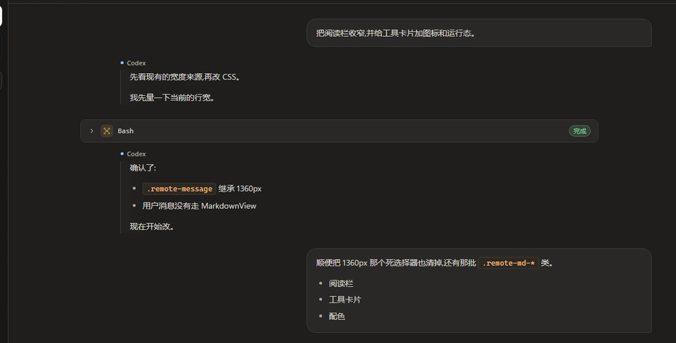

# AgentHub

> **官方 Agent 会话的统一远程继续与跨端控制面**  
> 支持在桌面浏览器、手机 PWA 与原生 Android 客户端随时接管 **Antigravity (`agy`)**、**OpenAI Codex**、**Claude Desktop**、**Claude Code**、**DeepSeek Harness** 以及动态安装的 **ACP 插件智能体** 会话。

<p align="center">
  <a href="README.md">English</a> •
  <a href="README_CN.md"><b>简体中文</b></a> •
  <a href="docs/README.md">文档索引</a> •
  <a href="docs/ARCHITECTURE.md">系统架构</a> •
  <a href="docs/CHANGELOG.md">更新日志</a>
</p>

<p align="center">
  <a href="https://github.com/xiaoran7/agenthub/releases"></a>
  <a href="https://github.com/xiaoran7/agenthub/actions/workflows/ci.yml"></a>
  <a href="LICENSE"></a>
  <a href="llms.txt"></a>
  
  
</p>

## 使用截图



早期版本的 AgentHub 远程 Web 端对话区实拍，展示 Codex 会话消息和工具执行状态。

---

## 核心定位

AgentHub 不重复造推理循环，而是通过官方原生协议托管本机 CLI 智能体。单二进制守护进程 `agenthub-runner`（`agenthubd`）以主动出站 TLS/WSS 连接自部署 Gateway，支持离开工位后查看实时输出流、展开脱敏 Diff 审批权限、回答多选提问、继续多轮对话或一键中断。

- **纯 Rust 单二进制 Runner**：内嵌零依赖本机控制台（`http://127.0.0.1:4200`）、按需隔离的 `agenthub-runner ui` WebView2 子进程、原生 Win32 托盘卡片、SQLite 冷热分层用量账本（`UsageIndexDb`）、本机权威 ACP 插件管理器（`~/.agenthub/plugins/`）及联邦能力生态（Skill / MCP / Hook）。
- **静态化 Web PWA 与原生 Android**：`apps/web` 采用 Vite 8 静态多页 + `nginx:1.29-alpine` 同源反代（常驻内存约 `8.4 MiB`），配合 `apps/android` Kotlin + Jetpack Compose 原生客户端共享同一套 Remote v3 契约。
- **主动出站零端口暴露**：开发机无需开放任何公网入站端口；Provider 凭据永不出本机，物理路径统一脱敏为 `ws-*` 工作区 ID。
- **核心精简与插件解耦**：原生聚焦 5 大核心槽位，其余智能体通过 SHA-256 校验的 ACP 插件仓库（`agenthub-plugins` 提供 `ZCode`、`Grok Build`、`Gemini CLI` 等扩展）按需在本机拉取执行，维持单写者 `host_generation` 隔离与 `client_cmd_id` 持久幂等。

## 架构拓扑

```text
开发机：Antigravity / Codex / Claude Desktop / Claude Code / DeepSeek Harness + ACP 插件
                    ▲  (官方原生协议 / ACP JSON-RPC 2.0)
                    ▼
        agenthub-runner (纯 Rust 守护进程, ~13.5 MB RSS, 插件权威源)
          ├─ 内嵌控制台与原生托盘 ──► http://127.0.0.1:4200
          └─ 主动出站 TLS / WSS  ──► 自部署 Gateway (@agent-pulse/api)
                                            │ (HTTPS / WSS / SSE)
                                            ▼
                            Vite + Nginx 远程 Web 端 / Android 原生端
```

## 快速开始

### 1. 本机 Runner 与内嵌控制台

```bash
agenthub-runner web      # 启动本机控制台 (http://127.0.0.1:4200)
agenthub-runner daemon   # 常驻后台守护模式
```

### 2. 源码启动全栈套件（Node >= 22, Rust 2024 工具链）

```powershell
npm.cmd ci
npm.cmd start --workspace @agent-pulse/api    # 启动 Gateway (http://127.0.0.1:3001)
npm.cmd run dev --workspace @agent-pulse/web  # 启动 Vite Web 端 (http://127.0.0.1:5173)
cargo run -p agenthub-runner -- daemon        # 启动本机 Rust Runner
```

### 3. 自动化门禁

```powershell
python scripts/check-line-limits.py
cargo fmt --all --check && cargo clippy --workspace --all-targets -- -D warnings && cargo test --workspace
npm.cmd run format:check && npm.cmd run typecheck && npm.cmd test
```

## 开源引用与上游溯源

| 上游项目 | 开源协议 | 在本项目中负责的模块 |
| :--- | :--- | :--- |
| [magpie](https://github.com/yetone/magpie) | MIT, Copyright (c) 2026 yetone | 本机内嵌控制台设计令牌与布局原语（`crates/runner/resources/dashboard.{html,css,js}`）、厂商图标集（`crates/runner/resources/icons/`）、逐请求用量账本（`usage_ledger/`）及跨智能体能力资料库（`collectors/capabilities/`） |
| [stablyai/orca](https://github.com/stablyai/orca) | Apache 2.0 / MIT | 移动端控制舱布局理念、终端虚拟按键配件行与深浅令牌体系（`apps/android`） |

## 核心文档索引

- **[AGENTS.md](AGENTS.md)**：工程纪律、安全红线与模块边界
- **[docs/README.md](docs/README.md)**：文档导航与各模块实现状态
- **[docs/PRD.md](docs/PRD.md)** / **[docs/ARCHITECTURE.md](docs/ARCHITECTURE.md)**：产品定义、组件拓扑与资源实测
- **[docs/SYNC_PROTOCOL.md](docs/SYNC_PROTOCOL.md)**：本地 IPC v2、Remote v3 WSS、水位 ACK 与幂等状态机
- **[docs/DEPLOYMENT.md](docs/DEPLOYMENT.md)** / **[docs/PITFALLS.md](docs/PITFALLS.md)**：Docker / Systemd / Nginx 部署指南与避坑清单
- **[llms.txt](llms.txt)** / **[llms-full.txt](llms-full.txt)** / **[docs/CHANGELOG.md](docs/CHANGELOG.md)**：机器可读契约与全量更新日志

## 许可证

基于 [MIT 许可证](LICENSE) 开源。
