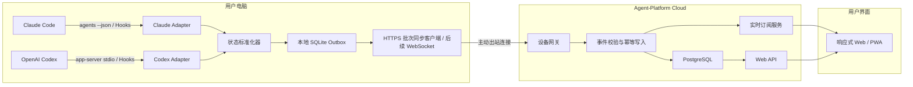

# Agent-Platform MVP 系统架构

> 本文是当前实现的设计权威。行为变更必须同步更新本文，并在
> [CHANGELOG.md](CHANGELOG.md) 留痕；具体取舍见 [MISC.md](MISC.md)。

## 1. 架构目标

MVP 只解决一个问题：

> 安全、准确、低延迟地收集用户电脑上的 Claude Code 与 Codex Session
> 元数据，并在网页和移动界面统一展示。

架构优先级：

1. 不接触 Agent 登录 Token。
2. 不默认上传代码、完整对话和环境变量。
3. 状态有明确来源与置信度。
4. 本地客户端只建立出站连接。
5. Agent 适配器可以独立升级和扩展。

## 2. 总体架构



## 3. 本地 Runner

### 3.1 模块

#### Device Identity

- 首次运行生成 Ed25519 设备密钥，设备 ID 由公钥 SHA-256 摘要的前 128 位派生。
- 私钥仅保存在本地身份文件，创建时禁止覆盖；写入使用同目录临时文件加不覆盖式
  落位，崩溃不会留下半写身份文件。Unix 新文件权限为 `0600`。
- 设备身份同时派生项目目录 HMAC 指纹密钥，避免手工配置两套不一致身份。
- 通过一次性绑定码与用户账号绑定。
- 云端仅保存设备公钥；同步批次由设备私钥签名。
- 支持用户从云端撤销设备。

当前已实现本地身份的创建、加载、完整性校验、公开信息展示，以及通过开发期一次性
绑定码将公钥登记到 Gateway。Windows 文件沿用父目录 ACL，主动 ACL 加固、系统密钥
库托管、正式账号绑定、撤销与轮换尚未实现。

#### Adapter Supervisor

- 检测 Agent 是否安装。
- 获取 Agent 版本。
- 启动、停止和重启适配器。
- 对失败使用指数退避；云端多设备同步接入时再增加抖动。
- 不允许适配器读取无关目录。

当前 Runner 已实现：

- Claude 与 Codex 独立持续采集源。
- 活动 Session 2 秒、空闲 10 秒的自适应轮询。
- 失败从 2 秒指数退避到最多 60 秒。
- `Ctrl-C` 协作式退出和诊断用最大尝试次数。
- 适配器健康状态写入 SQLite，只保存固定安全错误码。
- 状态快照无变化时不生成重复 Outbox 事件；入队事件携带与本地快照一致的合并后
  状态，并保留本次观察自身的事件 ID 与观察时间。
- 所有采集子进程和协议请求默认 15 秒强制超时。
- Windows 使用 Job Object、Unix 使用独立进程组管理采集子进程树，超时或退出时
  终止所有后代进程，并保证先杀进程树再回收读取线程。
- Codex 被动通知与 `thread/list`、`thread/loaded/list` 轮询结果合并；带
  `method` 的服务端消息不会被当作请求响应吞掉。
- SQLite 连接设置 busy_timeout，与 hook 进程并发写时等待而非立即失败；本地
  数据库暂时性错误按采集失败退避，不终止守护进程。

尚未完成 Codex 跨客户端实时通知覆盖的真实 CLI 验证；轮询仍是权威兜底。

#### Claude Adapter

数据来源：

1. 周期调用 `claude agents --json`。
2. 用户允许时调用 `claude agents --json --all` 获取最近完成的后台 Session。
3. 接收 Agent-Platform Claude Hook 的本地事件。
4. 使用本地索引记录 Runner 安装后的历史 Session。

建议查询周期：

- 有活动 Session：2 秒。
- 无活动 Session：10 秒。
- CLI 调用失败：指数退避，最长 60 秒。

#### Codex Adapter

数据来源：

1. 使用 stdio 启动 `codex app-server`。
2. 使用 `thread/list` 获取持久化 Thread 元数据。
3. 使用 `thread/loaded/list` 和状态通知观察 Runner app-server 中的活动 Thread。
4. 接收 Agent-Platform Codex Hook 的本地事件。
5. 被动处理当前连接收到的 Turn、审批和用户输入事件。

Runner 不监听公网端口，也不使用 app-server 的实验性 WebSocket transport。
为保持第一阶段只读，Runner 不调用 `thread/start` 或 `thread/resume` 来获取通知。
初始化时显式退出消息、推理、计划、Diff、命令输出等内容型通知，只保留状态判断所需
的元数据事件。官方只保证连接启动或恢复 Thread 后的 Turn/Item 通知，因此当前连接
对其他客户端 Thread 的实时覆盖不能先验保证，必须由轮询兜底并在真实 CLI 上验证。

#### Normalizer

- 将 Agent 原始事件转换为统一事件。
- 保留原始状态名，但剔除敏感载荷。
- 计算置信度。
- 使用状态优先级和 TTL 解决冲突。
- 生成稳定的 Session 主键：

```text
session_key = agent_type + device_id + agent_session_id
```

#### Local SQLite Outbox

本地数据库只保存：

- 待同步的白名单事件
- 最近一次 Session 快照
- 事件序列号
- 适配器游标
- 适配器健康状态和退避信息
- 设备绑定信息
- 用户允许保存的项目别名

网络断开时继续写入 Outbox；恢复连接后按序重放。成功确认后清理已发送事件。

当前已实现 HTTP 同步闭环：从 Outbox 生成最多 1000 个事件的 Ed25519 签名批次，
通过主动出站请求上传，并仅在确认的设备、批次和序列均匹配实际发送范围时清理事件。
每次推送的批次和单批事件数均有上限；网络失败或无效响应保留未确认事件。远程服务
强制 HTTPS，本地开发允许回环 HTTP。具体线格式见
[SYNC_PROTOCOL.md](SYNC_PROTOCOL.md)。

常驻 `run` 在配置 Gateway 与设备身份后启动独立后台同步线程。线程启动即扫描磁盘
Outbox，采集提交新事件后通过容量为 1 的合并信号立即唤醒；网络失败按独立指数退避，
退避期间继续采集。同步与采集各持一个 SQLite 连接，依赖 WAL 与 `busy_timeout`
协调，不共享网络阻塞。在途批次持久化、独立设备心跳和 WebSocket 低延迟通道仍属于
Milestone 2。

### 3.2 本地 IPC

Hooks 不直接访问云端。推荐：

- Windows：Named Pipe
- macOS/Linux：Unix Domain Socket
- 兼容兜底：仅监听 `127.0.0.1` 的随机高端口，并使用安装时生成的本地密钥

Runner 对 Hook 输入执行固定 Schema 校验和字段白名单，不接受任意文件路径、
命令或网络目标。

## 4. 云端服务

### 4.1 Device Gateway

- 接收 Runner 的 TLS WebSocket 出站连接。
- 验证设备凭据。
- 处理心跳、快照和增量事件。
- 为每个设备限制连接数和事件速率。

当前已实现开发期 HTTP 协议入口：

- 一次性绑定码将设备公钥关联到用户；注册必须携带设备私钥对注册字段的 Ed25519
  持有证明签名，公开可见的公钥不能被第三方抢注。同一设备重试幂等，绑定码不能
  转给其他设备；注册被存储拒绝时绑定码回滚，不会被失败请求烧毁。
- 批次进入存储前执行深层字段白名单、协议/Schema 版本、设备 ID、公钥、连续序列和
  Ed25519 签名校验。校验顺序为：结构与字段白名单 → 公钥派生设备 ID → 签名 →
  存储层注册与序列约束。签名字节需要从解析后的规范形式重建，因此结构校验必然
  先于验签；任何数据落库前签名与注册检查都已通过。
- `x-user-id` 仅用于模拟已认证读请求，不是生产认证方案。
- Runner 已可调用登记与批次接口，并验证有界确认后清理 Outbox。
- 默认只监听 `127.0.0.1`；尚未实现 TLS WebSocket、心跳、速率限制和正式鉴权。

建议：

- 心跳间隔：15 秒。
- 离线判定：连续 45 秒没有心跳。
- 连接恢复后先发送完整快照，再发送 Outbox 增量。

### 4.2 Event Ingestion

每个事件包含：

```text
event_id
device_id
sequence
agent_type
agent_session_id
event_type
observed_at
source
confidence
payload
schema_version
adapter_version
```

Runner 使用带 `protocol_version`、`batch_id`、设备公钥、首末序列和签名的批次封装
上述事件。签名覆盖批次元数据和全部事件；网关必须先验证“公钥派生的设备 ID”与签名，
再进行事件白名单校验。

写入规则：

- `event_id` 幂等。
- 同一设备的 `sequence` 单调递增。
- 云端拒绝不在白名单中的字段。
- 确认序列不得超过该批次实际发送的 `last_sequence`。
- 服务器记录接收时间，但不替换设备观察时间。
- 快照与增量事件均可重放。

`InMemoryGatewayStore` 和 `PostgresGatewayStore` 共用异步存储契约：按 `event_id`
幂等、按 `device_id + sequence` 检测冲突，并拒绝新增序列间隙；Session 快照按
观察时间、置信度和设备序列合并。内存实现用于快速协议测试，不提供持久性。
PostgreSQL 实现按设备行锁串行化批次，在一个事务内完成冲突检查、事件写入、快照
合并、水位和最后在线时间更新；失败时整体回滚。

### 4.3 Storage

MVP 使用 PostgreSQL：

- `users`
- `devices`
- `device_credentials`
- `agent_installations`
- `sessions`
- `session_status_events`
- `device_connections`

当前首版迁移已实现：

- `agent_platform_devices`
- `agent_platform_events`
- `agent_platform_sessions`
- `agent_platform_schema_migrations`

事件原文只保存已经通过 Contracts 白名单验证的 `SyncEvent` JSONB；Presence 和
Activity Status 额外保留受约束列用于筛选。迁移使用事务级 advisory lock 防止多个
实例同时执行，并记录 SQL SHA-256 防止同版本迁移被静默改写。开发期绑定码仍在进程
内，用户、凭据轮换、连接心跳等表随正式认证与实时通道实现。

实时广播可以先使用 PostgreSQL `LISTEN/NOTIFY`，达到单机瓶颈后再引入 Redis
Pub/Sub。MVP 不必一开始维护两套基础设施。

### 4.4 Web API 与实时订阅

读接口：

- 获取设备列表
- 获取设备 Agent 列表
- 获取活动 Session
- 获取等待处理 Session
- 获取最近完成 Session
- 获取历史 Session
- 获取 Session 状态事件

实时接口只推送元数据变化，不推送 transcript。

当前已实现 `GET /v1/devices`、`GET /v1/sessions` 和 `GET /v1/sessions/events`。
Session 可按设备、Presence 和 Activity Status 过滤；状态事件时间线按
`device_id + agent_type + agent_session_id` 定位会话，按 `sequence` 降序返回，
`limit` 默认 100、上限 500，查询按 owner 隔离。设备在线状态按最近批次接收时间
和 45 秒阈值计算；心跳尚未接入，因此无新事件的设备会按阈值离线。

实时订阅为 `GET /v1/stream`（Server-Sent Events，owner 维度）。批次入库且确实
产生新事件时推送一帧 `event: sessions`，内容只有 `device_id` 与本批接收数量：
**通道只负责"有变化"信号，会话数据一律回读上述查询接口**，因此实时通道不可能
偏离读接口已经执行的字段策略。每 20 秒发一条注释心跳；单 owner 并发流上限 8 条，
超出返回 429。当前 broker 是进程内实现，多实例部署前不能取消轮询兜底。

### 4.5 Web Push 通知

面板关闭时靠 Web Push 提醒"有会话在等人"。`GET /v1/push/key` 返回 VAPID 应用
服务器公钥（未配置密钥时 404 `push_disabled`，功能整体关闭而不是半开）；
`POST`/`DELETE /v1/push/subscriptions` 增删订阅，endpoint 必须是 HTTPS 且不带
凭据，p256dh/auth 按长度和点格式校验后才入库。

只有会话的活动状态**跃迁进入** `WAITING_INPUT` 或 `WAITING_PERMISSION` 才发
通知；完成、失败、离开等待都不打扰用户。通知负载只含面板已经展示的字段
（设备、Agent 类型、会话 ID、项目显示名、状态、等待原因、观察时间），不含任务
文本、原始状态明细和工作目录。发送在请求路径之外进行：Runner 上传不等待第三方
推送服务，推送失败也不会把已入库的批次变成 Runner 会重试的错误。推送服务返回
404/410 的订阅立即删除。

加密按 RFC 8188 `aes128gcm` + RFC 8291 密钥派生，授权按 RFC 8292 VAPID，均基于
`node:crypto` 自实现，由 RFC 8291 官方示例向量钉死。

## 5. 状态数据模型

“历史”不是运行状态。平台使用两个独立维度。

### 5.1 Presence

| 值 | 含义 |
| --- | --- |
| `LIVE` | 最近收到权威实时信号，或确认进程仍存活 |
| `PERSISTED` | 仅存在持久化记录，当前没有可信实时信号 |
| `UNKNOWN` | 无法确认是否仍有活动进程 |

### 5.2 Activity Status

| 值 | 含义 |
| --- | --- |
| `WORKING` | 正在生成、调用工具或执行命令 |
| `WAITING_INPUT` | 等待用户回答问题 |
| `WAITING_PERMISSION` | 等待权限、命令或文件变更审批 |
| `IDLE` | Session 可继续，但当前没有任务 |
| `COMPLETED` | 最近一个 Turn 正常完成 |
| `FAILED` | 最近一个 Turn 执行失败 |
| `STOPPED` | 最近一个 Turn 或 Session 被主动停止 |
| `UNKNOWN` | 无法可靠判断 |

UI 中的“历史会话”筛选条件为：

```text
presence = PERSISTED
```

而不是 `activity_status = HISTORICAL`。

### 5.3 状态记录

```json
{
  "presence": "LIVE",
  "activity_status": "WAITING_PERMISSION",
  "raw_status": "blocked",
  "raw_status_detail": {
    "waiting_for": "permission prompt"
  },
  "source": "claude_agents_json",
  "confidence": "authoritative",
  "observed_at": "2026-07-25T12:00:00Z"
}
```

`raw_status_detail` 也必须经过字段白名单，不保存完整命令、Prompt 或工具参数。

## 6. 状态映射

### 6.1 Claude Code

| 原始信号 | Presence | Activity Status | Confidence |
| --- | --- | --- | --- |
| `state=working` | `LIVE` | `WORKING` | `authoritative` |
| `state=blocked`, `waitingFor=permission prompt` | `LIVE` | `WAITING_PERMISSION` | `authoritative` |
| `state=blocked`, `waitingFor=sandbox request` | `LIVE` | `WAITING_PERMISSION` | `authoritative` |
| `state=blocked`, `waitingFor=input needed` | `LIVE` | `WAITING_INPUT` | `authoritative` |
| `state=blocked`, `waitingFor` 无法识别 | `UNKNOWN` | `UNKNOWN` | `inferred` |
| `state=done` | `LIVE` 或 `PERSISTED` | `COMPLETED` | `authoritative` |
| `state=failed` | `LIVE` 或 `PERSISTED` | `FAILED` | `authoritative` |
| `state=stopped` | `LIVE` 或 `PERSISTED` | `STOPPED` | `authoritative` |
| `UserPromptSubmit` Hook | `LIVE` | `WORKING` | `observed` |
| `PermissionRequest` Hook | `LIVE` | `WAITING_PERMISSION` | `observed` |
| `Elicitation` Hook | `LIVE` | `WAITING_INPUT` | `observed` |
| `Stop` Hook | `LIVE` | `COMPLETED` | `observed` |
| `StopFailure` Hook | `LIVE` | `FAILED` | `observed` |
| `SessionEnd` Hook | `PERSISTED` | 保留最近状态 | `observed` |

### 6.2 Codex

| 原始信号 | Presence | Activity Status | Confidence |
| --- | --- | --- | --- |
| `thread.status=active` | `LIVE` | `WORKING` | `authoritative` |
| `thread.status=idle` | `LIVE` | `IDLE` | `authoritative` |
| `thread.status=systemError` | `LIVE` | `FAILED` | `authoritative` |
| `turn/started` | `LIVE` | `WORKING` | `authoritative` |
| `turn/completed: completed` | `LIVE` | `COMPLETED` | `authoritative` |
| `turn/completed: interrupted` | `LIVE` | `STOPPED` | `authoritative` |
| `turn/completed: failed` | `LIVE` | `FAILED` | `authoritative` |
| 任意 `requestApproval` | `LIVE` | `WAITING_PERMISSION` | `authoritative` |
| `requestUserInput` | `LIVE` | `WAITING_INPUT` | `authoritative` |
| `mcpServer/elicitation/request` | `LIVE` | `WAITING_INPUT` | `authoritative` |
| `UserPromptSubmit` Hook | `LIVE` | `WORKING` | `observed` |
| `PermissionRequest` Hook | `LIVE` | `WAITING_PERMISSION` | `observed` |
| `Stop` Hook | `LIVE` | `COMPLETED` | `observed` |
| `SessionEnd` Hook | `PERSISTED` | 保留最近状态 | `observed` |
| `thread.status=notLoaded` | `UNKNOWN` | 保留最近状态 | `inferred` |
| `thread/closed` | `UNKNOWN` | 保留最近状态 | `inferred` |
| 未识别的 thread 状态或方法 | 按信号推断 | 保留最近状态 | `inferred` |

特别注意：`notLoaded` 不能直接映射为历史或停止；所有无法识别的状态与方法一律
降为 `inferred` 置信度，不得以权威级伪造判断。带 `pid`/存活证据的 `stopped`
Presence 为 `LIVE`（§5.1 对 LIVE 的定义以进程存活为准），"历史会话"过滤只看
`presence = PERSISTED`。

## 7. 冲突处理

状态更新排序依据：

1. `observed_at`
2. `confidence`
3. `source_priority`
4. `sequence`

规则：

- 较旧事件不能覆盖较新事件。
- 同一时间附近，`authoritative` 高于 `observed`，`observed` 高于 `inferred`。
- 等待状态只由明确等待事件设置。
- 等待请求解决后，没有收到新的工作事件时先回到 `WORKING`，等待 Turn
  完成事件决定最终状态。
- 设备离线只改变设备在线状态，不擅自把所有 Session 标记为失败或停止。
- `LIVE` 信号超过 TTL 后转为 `UNKNOWN`；确认只有持久化记录后再转为
  `PERSISTED`。

## 8. 隐私字段策略

### 8.1 默认允许同步

- Agent 类型和版本
- Session ID
- 设备 ID
- 项目显示名（工作目录恰为当前用户主目录时固定为 `home`，不上传用户名）
- 工作目录设备内指纹
- Presence 与统一状态
- 原始状态枚举
- 等待原因枚举
- 开始、活动和状态变化时间
- 状态来源与置信度

### 8.2 默认禁止同步

- OAuth Token、API Key、Cookie
- `auth.json`
- 完整工作目录
- 完整 Prompt 或对话
- 工具输入和工具输出
- Shell 命令正文
- 代码、Diff 和测试日志
- 环境变量与 `.env`
- transcript/rollout 文件

### 8.3 任务摘要

MVP 默认 `task_summary = null`。

如果原始 Agent 提供明确的短标题或公开摘要，可在用户开启“同步任务摘要”后上传。
不能为了生成摘要而默认读取完整 transcript 或额外调用模型。

## 9. 推荐技术栈

### Runner

- Rust；当前采集调度使用标准线程，接入网络同步时再评估 Tokio
- SQLite
- serde / JSON Schema 校验
- OS 原生服务：
  - Windows Service
  - macOS LaunchAgent
  - Linux systemd user service

选择 Rust 的原因是单文件部署、较低常驻资源占用和更适合本地进程管理。

### Cloud API

- TypeScript 7
- Fastify 5
- PostgreSQL
- WebSocket
- OpenAPI + JSON Schema

### Web 与移动端

- Next.js（当前为 16.x：Next 15 不支持仓库统一的 TypeScript 7，16 需启用
  `experimental.useTypeScriptCli`）
- 响应式 Web + PWA
- 第一阶段不单独开发原生 iOS/Android App

PWA 足以完成只读监控和通知验证，能够降低第一阶段重复开发成本。需要可靠的
原生推送、后台能力或商店分发时，再增加原生壳或 React Native 客户端。

### Repository

建议结构：

```text
Agent-Platform/
  apps/
    web/
  services/
    api/
  crates/
    runner/
  packages/
    contracts/
  docs/
```

## 10. MVP 开发顺序

### Milestone 0：协议探针

- Claude `agents --json` 采集探针
- Claude Hook 事件接收探针
- Codex app-server stdio 客户端探针
- Codex Hook 事件接收探针
- 保存脱敏后的样例事件 Fixture

完成标准：在真实电脑上证明两种 Agent 的工作、等待审批、等待输入、完成、
失败和停止事件能够被识别。

### Milestone 1：本地 Runner

- 设备身份（已完成本地生成、校验、签名和开发期绑定；撤销与密钥库待完成）
- 两个 Agent Adapter（已完成一次性与持续采集；实时订阅待完成）
- 状态标准化器（已完成）
- SQLite Outbox（已完成）
- 本地诊断命令（已完成基础统计、待发送事件和 Adapter 健康状态）

### Milestone 2：云端同步

- 设备绑定（已完成开发期一次性绑定码、公钥登记和 Runner 出站调用）
- WebSocket Gateway（已完成 Runner→Gateway HTTP 批次闭环，WebSocket 待接入）
- 后台自动同步（已完成启动排空、新事件唤醒、独立退避与恢复重放）
- 心跳与离线判断（已完成接收时间阈值，独立心跳待接入）
- 幂等事件写入（已完成 Runner 上传/确认、内存与 PostgreSQL 事务存储）
- Session 查询 API（已完成开发期设备和 Session 读接口）

### Milestone 3：响应式 Web / PWA

- 设备列表（已完成：在线状态、最近上报、点击筛选）
- 活动 Session（已完成）
- 等待处理（已完成，列表中置顶）
- 最近完成（已完成）
- 历史列表（已完成，`presence = PERSISTED` 过滤）
- Session 详情与状态时间线（已完成，基于 `GET /v1/sessions/events`）
- 实时刷新（已完成，基于 `GET /v1/stream`，轮询保留为兜底）
- Service Worker 与推送通知（已完成；等待输入/等待权限时推送，需配置 VAPID）

面板位于 `apps/web`，可见性暂停周期刷新（首次拉取不受可见性影响）、深浅色与
移动端适配、PWA manifest。变化经 `GET /v1/stream` 实时到达，轮询降级为兜底
（连上流 30 秒、断流 5 秒）。开发期同源代理访问网关：普通请求走 Next rewrites，
SSE 走 `app/v1/stream/route.ts`（rewrites 会缓冲响应体）。

Service Worker（`public/sw.js`）只处理 `push` 与 `notificationclick`，没有
fetch 处理器也不做离线缓存——引入它是因为 Web Push 强制要求，不是为了离线。
点击通知聚焦已打开的面板并用 postMessage 传递会话引用，标识不进 URL。

M3 已全部完成。M4 已完成自动化基线，并在本机 PostgreSQL 18.4 与 Codex CLI
0.144.2 上补充现场证据；跨实例广播、心跳与正式认证仍在 M2 遗留清单上。

### Milestone 4：安全与稳定性

- 字段泄漏测试（自动化基线已完成：Adapter → Outbox → 签名批次）
- 断网重放测试（自动化基线已完成：磁盘 Outbox 失败不 ACK，跨进程重开后原序重放）
- Agent 升级兼容测试（新版 Fixture 已完成；Codex 当前版本只读采集已通过，真实
  升级前后状态矩阵待验证）
- Hook 禁用和未信任降级（自动化基线已完成）
- 多设备和大量 Session 压力测试（内存 Store 与 PostgreSQL 18.4 的
  12 设备/3000 Session 均已实际通过）

详细证据与未验证边界见 [M4_VALIDATION.md](M4_VALIDATION.md)。M4 保持“进行中”，
直到真实 Agent 升级矩阵、TLS/长时间离线恢复和系统级 Web Push 呈现完成；不得用
Fixture、一次性当前版本采集或订阅成功替代这些结论。

## 11. Milestone 0 验收矩阵

| 场景 | Claude | Codex |
| --- | --- | --- |
| 新建 Session | 必须识别 | 必须识别 |
| 恢复 Session | 必须识别 | 必须识别 |
| 正在工作 | 必须识别 | 必须识别 |
| 等待普通输入 | 必须识别 | 必须识别 |
| 等待权限 | 必须识别 | 必须识别 |
| 正常完成 | 必须识别 | 必须识别 |
| 执行失败 | 必须识别 | 必须识别 |
| 主动停止 | 必须识别 | 必须识别 |
| Agent 进程崩溃 | 至少变为未知 | 至少变为未知 |
| 设备断网再恢复 | 不丢事件 | 不丢事件 |
| 不读取 Token | 必须证明 | 必须证明 |
| 不上传 transcript | 必须证明 | 必须证明 |

任何一个“必须识别”场景无法通过稳定官方接口或 Hook 实现时，应在开始云端开发
前调整 MVP 承诺。
