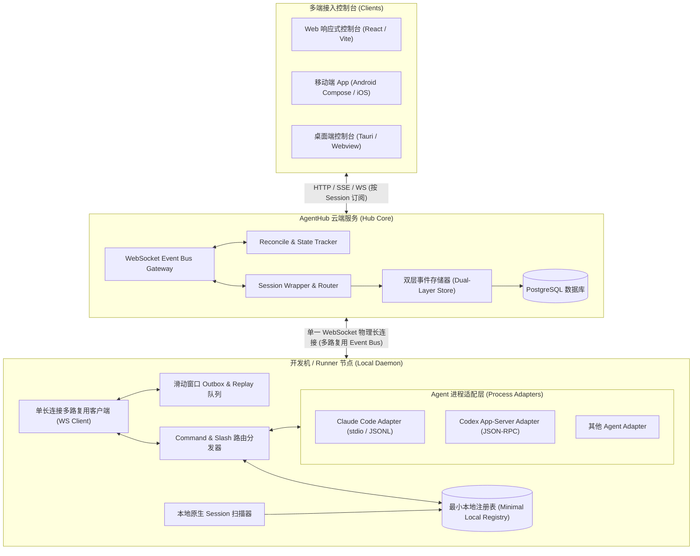
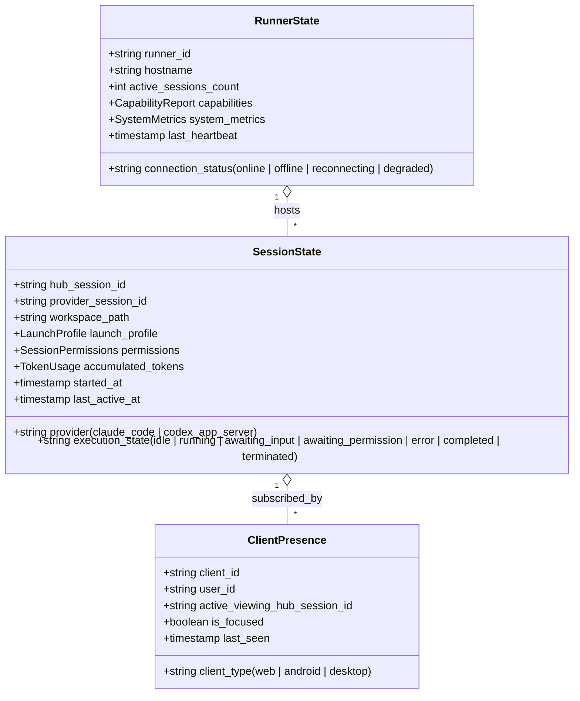
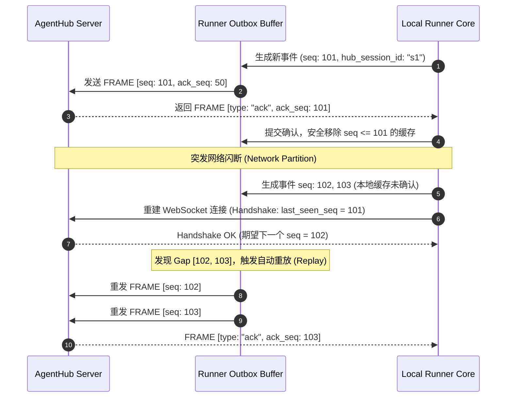
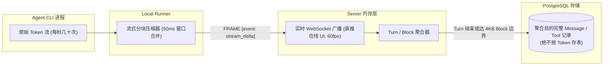
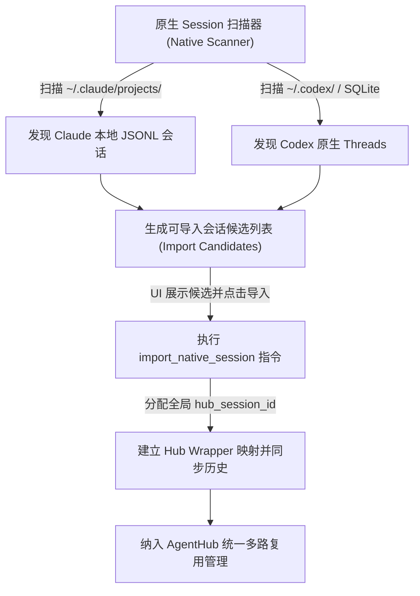

# AgentHub 系统架构设计规范 (Architecture v2.0)

> **版本**：2.0.0-spec  
> **更新日期**：2026-09-01  
> **设计地位**：AgentHub 全系统技术架构与实现基准。

---

## 1. 架构目标与设计原则

AgentHub 是面向多 Coding Agent（Claude Code、OpenAI Codex、Antigravity 等）的**统一远程控制平面（Unified Multi-Agent Remote Plane）**。全系统架构围绕以下核心目标构建：

1. **单连接多路复用**：单个 Runner 节点与 Server 仅维系一条物理 WebSocket 长连接，承载所有 Agent 会话、控制命令与事件广播。
2. **唯一真相源（SSOT）**：本地 Agent 真实进程是状态与对话的唯一权威，Hub 协议层不做无事实依据的推测。
3. **分层状态模型**：Runner 节点物理状态、Session 会话生命周期状态、Client Presence 客户端在线感知三者彻底解耦。
4. **可靠传输（ACK + Replay）**：从 v1 起提供工业级滑动窗口缓冲与断线重放机制，杜绝偶发网络抖动造成数据丢失。
5. **双层事件持久化**：服务端同时持久化「规范化业务事件（Normalized）」与「Provider 原始事件（Raw）」。
6. **存储流式优化**：高频 Token Delta 实时流式推送至 UI，但在数据库持久化时按 Turn/Block 聚合落库，避免高 I/O 碎片化。
7. **本地自治与最小注册表**：Runner 维护轻量级本地注册表（Minimal Local Registry），具备断网自主运行与会话恢复能力。

---

## 2. 总体拓扑与组件架构



---

## 3. 三层解耦状态模型

系统严格区分并独立管理三种不同维度的状态：



### 3.1 状态边界与转换规则
1. **Runner 离线不等于 Session 销毁**：当 Runner 网络中断时，Runner 状态变为 `offline`，但其承载的所有 Session 状态变为 `disconnected_runner`（暂停远程控制，但保留完整历史与上下文）。当 Runner 重连并 Reconcile 通过后，Session 恢复对应执行状态。
2. **Presence 不影响 Agent 执行**：即使所有客户端全部断开（Presence 为 0），后台 Agent 依然正常执行耗时任务并写入 Local Registry 和 Outbox。Presence 主要用于控制流式推流的服务端 QoS 降级策略。

---

## 4. WebSocket 多路复用 Event Bus 架构

### 4.1 统一帧结构（Frame Envelope）

Runner 与 Server 之间的单条 WebSocket 连接中传输的所有数据均封装为统一的 Frame Envelope：

```json
{
  "ver": 2,
  "frame_id": "frm_01J6XYZ...",
  "type": "event | cmd | cmd_ack | ack | heartbeat | reconcile | presence",
  "seq": 1024,
  "ack_seq": 980,
  "hub_session_id": "hub_sess_01J8...", 
  "cmd_id": "cmd_01J9...", 
  "timestamp": 1725148800000,
  "payload": { ... }
}
```

- **`hub_session_id`**：可选。为空时代表 Runner 节点级控制帧（如节点心跳、能力上报、全局 Reconcile）；非空时代表具体 Session 的多路复用信道。
- **`seq` 与 `ack_seq`**：双向递增序列号与累计确认号，支撑 ACK + Replay 机制。
- **`cmd_id`**：客户端与 Server 发起的控制指令唯一追踪 ID，用于幂等去重。

### 4.2 双向 ACK 与滑动窗口重放（Sliding Window Replay）



---

## 5. 双层事件存储与流式聚合设计

### 5.1 双层存储结构

服务端对持久化数据采用双层存储模型（Dual-Layer Event Store）：

1. **规范化事件层（Normalized Events Table）**：
   - 统一抽象为 `USER_MESSAGE`、`AGENT_MESSAGE`、`TOOL_CALL_REQUEST`、`TOOL_CALL_RESULT`、`STATE_CHANGED`、`APPROVAL_REQUEST`、`APPROVAL_RESOLVED`。
   - 用于全端统一 UI 渲染、跨 Provider 检索与分析。
2. **Provider 原始事件层（Raw Events Table）**：
   - 存储 Provider 原生未修改的 JSON-RPC 消息、stdio 原始行、Claude JSONL 条目。
   - 用于高保真历史审计、深度调试以及向原生 CLI 的无损回放。

### 5.2 Token Delta 流式优化与存储聚合

高频流式输出处理策略：



---

## 6. 状态同步：事件流驱动 + 定期 Reconcile 校验

为防止网络极限异常下的状态漂移，AgentHub 采用混合同步机制：

1. **快速路径（Fast Path - 毫秒级）**：
   - Agent 状态一旦跃迁（如从 `running` 变为 `awaiting_permission`），Runner 立即构造事件帧推送到 WebSocket Event Bus。
2. **定期对齐路径（Reconcile Path - 30~60 秒周期）**：
   - Runner 定期向 Server 发送 `reconcile_check` 帧，携带当前本机所有活跃 Session 的状态指纹摘要：
     ```json
     {
       "runner_id": "run_01J6XYZ...",
       "active_sessions": [
         { "hub_session_id": "s1", "state": "running", "turn_id": 4, "state_hash": "a1b2c3..." },
         { "hub_session_id": "s2", "state": "idle", "turn_id": 12, "state_hash": "d4e5f6..." }
       ]
     }
     ```
   - Server 校验指纹。若发现不一致，向 Runner 发起针对该 Session 的 `sync_session_snapshot` 请求，实现状态自愈。

---

## 7. 本地最小注册表（Minimal Local Registry）

Runner 在本机维护轻量级 SQLite / WAL 文件注册表，保存最小必要状态：

```sql
CREATE TABLE local_sessions (
    hub_session_id TEXT PRIMARY KEY,
    provider_id TEXT NOT NULL,
    provider_session_id TEXT NOT NULL,
    workspace_path TEXT NOT NULL,
    execution_state TEXT NOT NULL,
    pid INTEGER,
    launch_profile_json TEXT NOT NULL,
    created_at INTEGER NOT NULL,
    updated_at INTEGER NOT NULL
);
```

- **断网生存**：Runner 进程重启或断网时，可根据本地注册表感知正在运行的子进程，防止孤儿进程。
- **重连恢复**：重连握手时将本地注册表与 Server 进行快速映射校验。

---

## 8. 本地原生 Session 扫描与导入机制



---

## 9. 并发操作、工作区冲突与安全控制

1. **多端并发与 Command ID 幂等**：
   - 所有来自 Web、Mobile 的控制动作必须附带 `client_cmd_id`。
   - Runner 内存保留最近 1000 条命令 ID 的执行结果缓存（TTL 10 分钟），重复请求直接返回缓存的 `cmd_ack`。
2. **同工作区多 Session 并行（Conflict Hints）**：
   - 允许在同一本地路径同时启动多个 Session（例如同时启动 Claude 审查和 Codex 编码）。
   - AgentHub 在 UI 上显示提示条：「当前工作区存在 2 个活跃会话」，并实时标注各会话正在读写的热点文件，给予冲突警示，但不引入破坏体验的强制全局文件锁。
3. **零凭据窃取与免责声明**：
   - Runner 仅以当前系统登录用户的权限拉起 Agent CLI，Agent 原生鉴权在 Agent 内部完成。
   - AgentHub 服务端与协议层绝不采集、不存储 Provider API Key 与 Token。
   - Transcript 内容由用户与 Agent 交互产生并完整持久化，责任边界清晰界定。
