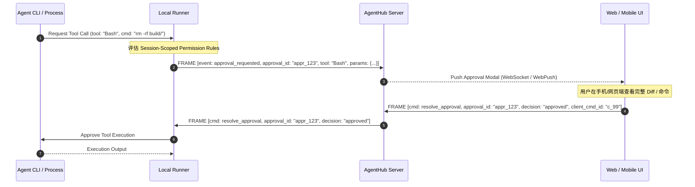
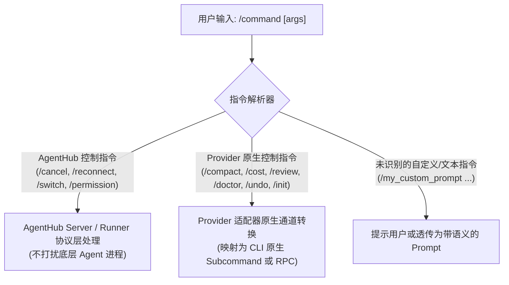

# AgentHub Launch Profile、能力发现与权限模型规范

> **版本**：2.0.0-spec  
> **更新日期**：2026-09-01  
> **地位**：AgentHub 会话创建、动态能力协商、指令分发与安全控制的权威规范。

---

## 1. 核心设计原则

1. **动态能力发现（Capability Discovery）**：不硬编码 Claude、Codex 或其他 Agent 的固定功能矩阵。Runner 启动时探测本机已安装 Agent CLI 的实际功能、模型列表与参数能力，并动态上报给 Server。
2. **显式创建配置（Launch Profile）**：Session 创建必须由明确结构化的 `LaunchProfile` 驱动，包含工作目录、目标 Provider、模型、思考强度、权限策略等完备参数。
3. **会话级权限控制（Session-Scoped Permissions）**：权限策略（审批级别、工具白名单/黑名单、自动放行规则）归属于单个 Session，严禁作为全局生效的静态配置。
4. **Slash 指令智能拦截分发**：`/` 指令在控制面被精确识别分类（AgentHub 级控制指令、Provider 原生操作指令、普通聊天输入），严禁直接当普通 Prompt 发送给 LLM。

---

## 2. 动态能力发现（Capability Discovery）

### 2.1 探测机制

Runner 在启动以及定期巡检时，针对系统 PATH 及预设路径探测已安装的 Coding Agent：

- **Claude Code 探测**：
  - 执行 `claude --version` 获取语义化版本号。
  - 解析支持的参数标志（如 `--thinking-budget`、`--permission-mode`、`--model`、`--dangerously-skip-permissions`）。
  - 读取本机可选模型列表与上下文限制。
- **OpenAI Codex 探测**：
  - 执行 `codex --version` 或初始化 `codex app-server` 连接探测能力。
  - 探测推理强度支持（`reasoning_effort`: `low` / `medium` / `high`）。
  - 探测沙箱隔离支持（`sandbox_mode`: `read_only` / `workspace_write` / `full_access`）。
- **通用能力提取**：
  - 提取支持的 Slash 指令集（如 `/compact`, `/cost`, `/review`, `/doctor`, `/undo`, `/reset`, `/init`）。

### 2.2 `CapabilityReport` 数据契约

在 WebSocket 握手阶段，Runner 向 Server 广播其探测到的能力清单：

```json
{
  "runner_id": "run_01J6XYZ...",
  "hostname": "workstation-alpha",
  "os": "windows",
  "architecture": "x86_64",
  "providers": [
    {
      "provider_id": "claude_code",
      "display_name": "Claude Code",
      "cli_version": "0.2.29",
      "executable_path": "C:\\Users\\Admin\\AppData\\Roaming\\npm\\claude.cmd",
      "available": true,
      "supported_models": [
        {
          "id": "claude-3-7-sonnet-20250219",
          "display_name": "Claude 3.7 Sonnet",
          "supports_thinking": true,
          "max_thinking_budget": 64000,
          "default_thinking_budget": 8000
        },
        {
          "id": "claude-3-5-haiku-20241022",
          "display_name": "Claude 3.5 Haiku",
          "supports_thinking": false
        }
      ],
      "supported_permission_modes": [
        "default",
        "accept_edits",
        "plan_only",
        "bypass_permissions"
      ],
      "supported_slash_commands": [
        "/compact",
        "/cost",
        "/review",
        "/doctor",
        "/init",
        "/clear"
      ],
      "supports_stream_cancellation": true
    },
    {
      "provider_id": "codex_app_server",
      "display_name": "OpenAI Codex",
      "cli_version": "0.144.2",
      "executable_path": "C:\\Program Files\\Codex\\codex.exe",
      "available": true,
      "supported_models": [
        {
          "id": "o3-mini",
          "display_name": "o3-mini",
          "supports_reasoning_effort": true,
          "supported_efforts": ["low", "medium", "high"],
          "default_effort": "medium"
        },
        {
          "id": "gpt-4.5-preview",
          "display_name": "GPT-4.5 Preview",
          "supports_reasoning_effort": false
        }
      ],
      "supported_permission_modes": [
        "ask_all",
        "auto_approve_reads",
        "full_access"
      ],
      "supported_slash_commands": [
        "/undo",
        "/reset",
        "/review",
        "/approval"
      ],
      "supports_stream_cancellation": true
    }
  ]
}
```

---

## 3. 会话启动配置（Launch Profile）

### 3.1 `LaunchProfile` 完整 Schema

创建会话时，由客户端组织并经 Server 验证的不可变配置对象：

```json
{
  "$schema": "https://agenthub.dev/schemas/v2/launch-profile.json",
  "workspace_path": "d:/ClaudeSpace/Project/solum",
  "workspace_display_name": "Solum",
  "target_runner_id": "run_01J6XYZ...",
  "provider": "claude_code",
  "model": {
    "model_id": "claude-3-7-sonnet-20250219",
    "reasoning": {
      "enabled": true,
      "effort_level": "high",
      "budget_tokens": 16000
    }
  },
  "permissions": {
    "approval_mode": "ask_all_edits",
    "allow_tool_execution": true,
    "tool_rules": [
      {
        "tool_name": "Bash",
        "action": "ask",
        "whitelist_commands": ["git status", "git diff", "cargo test"]
      },
      {
        "tool_name": "WriteFile",
        "action": "ask"
      },
      {
        "tool_name": "ReadFile",
        "action": "allow"
      }
    ]
  },
  "environment": {
    "custom_env_vars": {
      "RUST_BACKTRACE": "1"
    },
    "append_path": []
  },
  "session_metadata": {
    "title": "重构多路复用信道",
    "tags": ["backend", "refactor"],
    "created_by_client": "web_01J8ABC..."
  },
  "initial_prompt": "请检查当前工作目录下的网络协议实现并给出重构方案。"
}
```

### 3.2 字段约束与说明

| 字段 | 类型 | 是否必填 | 说明 |
|---|---|---|---|
| `workspace_path` | string | 是 | 本机绝对路径或标准化 URI，必须由 Runner 验证路径合法性 |
| `target_runner_id` | string | 是 | 承载此 Session 的目标 Runner 节点 |
| `provider` | enum | 是 | 严格限定为探测上报支持的 provider_id（如 `claude_code`, `codex_app_server`） |
| `model.model_id` | string | 是 | 必须在 Provider 声明的 `supported_models` 列表中 |
| `model.reasoning` | object | 否 | 思考预算/推理强度配置，需与模型特性匹配 |
| `permissions` | object | 是 | 会话作用域的权限控制规范 |
| `initial_prompt` | string | 否 | 会话初始化时附带的首条提示词 |

---

## 4. 会话级权限模型（Session-Scoped Permissions）

### 4.1 权限模式矩阵

| 权限模式（`approval_mode`） | 读文件/查询 | 写文件/修改 | 执行 Shell 命令 | 外部网络访问 | 适用场景 |
|---|---|---|---|---|---|
| `plan_only` | 自动允许 | **禁止** | **禁止** | **禁止** | 纯架构规划与只读代码审查 |
| `ask_all_edits` (默认) | 自动允许 | **每次弹窗审批** | **每次弹窗审批** | **每次弹窗审批** | 标准开发流程，安全可控 |
| `accept_edits` | 自动允许 | 自动允许 | **每次弹窗审批** | 自动允许 | 快速编码，拦截危险系统命令 |
| `bypass_permissions` | 自动允许 | 自动允许 | 自动允许 | 自动允许 | 容器或受信任隔离沙箱 |

### 4.2 审批交互生命周期



---

## 5. Slash 指令智能拦截与路由分发

在 AgentHub 统一输入框中，用户输入的以 `/` 开头的指令不会被无脑当做普通的 LLM Prompt，而是经过**三层路由分类器**：



### 5.1 指令分发表

| 指令 | 级别 | 处理方式 | 说明 |
|---|---|---|---|
| `/cancel` 或 `/stop` | AgentHub | 向 Runner 发送 `interrupt_turn` 信号 | 立即中止当前 Agent 的流式输出或工具执行 |
| `/permission <mode>` | AgentHub | 动态变更当前 Session 的 `approval_mode` | 运行时调整审批策略，不需要重启 Session |
| `/compact` | Native (Claude) | 映射为 Claude 原生上下文压缩指令 | 执行上下文剪枝压缩，减少 Token 消耗 |
| `/cost` | Native (Claude) | 映射为 Claude 原生费用与 Token 统计 | 获取当前会话准确消耗与模型调用明细 |
| `/review` | Native (Claude/Codex) | 映射为代码 Diff 审查流程 | 触发 Agent 对未提交修改进行审查 |
| `/doctor` | Native (Claude) | 映射为环境与依赖诊断 | 输出当前开发环境健康报告 |
| `/undo` | Native (Codex) | 映射为 Codex 回滚上一步修改 | 撤销上一个 Turn 的代码生成与文件修改 |
| `/clear` | AgentHub | 清空前端渲染视图（保留底层历史） | 重置 UI 滚动区域 |
