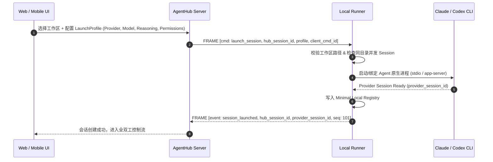

# AgentHub 产品需求文档 (PRD v2.0)

> **版本**：2.0.0-spec  
> **更新日期**：2026-09-01  
> **文档状态**：基准规范（全面完成 28 项核心架构重定界）

---

## 1. 产品概述与核心定位

### 1.1 产品愿景与定位

**AgentHub 是一个面向多 Coding Agent 的统一远程控制平面（Unified Multi-Agent Remote Plane）。**

在当今的 AI 辅助软件工程中，开发者通常会在同一台开发机上并行使用多种强大的 Coding Agent（例如 Claude Code、OpenAI Codex、Antigravity 等）。以往开发者为了进行远程控制与移动端协作，必须在本地分别运行各个 Agent 各自的原生 Remote 守护进程，并在多个割裂的 Web 页面与移动 App 之间来回切换。

**AgentHub 彻底终结这种碎片化体验。** 开发者只需在本机运行一个轻量级的 `AgentHub Runner`，即可通过单一长连接把本机所有的 Claude Code、Codex、Antigravity 等会话统一接入到云端控制中心。无论在网页端还是移动端，开发者都可以使用统一的交互界面实现：
- 跨 Agent 会话的全局管理与实时监控
- 原生级别的全双工流式交互与 Prompt 输入
- 细粒度的工具执行审批与权限控制
- 智能的 Slash (`/`) 指令拦截与分发
- 本地已有历史原生会话的无缝发现与导入

---

## 2. 核心架构与产品定界原则 (28 项铁律)

本项目严格恪守以下 28 项核心定界原则：

1. **服务器允许保存会话内容**：服务端完整持久化 Session 对话正文、工具调用、输入输出及执行时间线，支持全端完整离线回放与历史查询。
2. **不保存敏感凭据**：AgentHub 绝不主动采集、窃取或集中管理 Provider Credential Store（如 `~/.claude/.credentials.json` 或 OpenAI auth 文件）；不对用户或 Agent 在 Transcript 中自主打印的敏感信息做额外保证，明确责任边界。
3. **Provider 严格隔离**：Claude 的 session 永远是 Claude 的，Codex 的 session 永远是 Codex 的。严禁跨 Provider 伪造或复用会话执行上下文。
4. **统一远程控制面**：核心价值在于合并多 Agent 的 Remote 接入，一台机器只需运行一个 AgentHub Runner。
5. **借鉴开源优秀实践**：深度吸收 Claude Code stdio / Codex app-server / Agent Protocol / OpenHands 等开源前沿设计。
6. **工作目录作为一级组织单位（Workspace-First）**：Session 不按 Provider 粗暴分类，工作区（项目路径）才是一级组织单位。
7. **遵循官方协议标准同步状态**：严格依照官方 Agent 协议与状态机对齐生命周期。
8. **显式创建与精细化管理**：提供结构化的会话创建机制（指定 Runner、模型、思考强度、权限等级等）。
9. **单一 WebSocket 长连接多路复用**：每个 Runner 节点对 Server 仅维持一条 WebSocket 物理长连接，多路复用所有 Session 信道。
10. **原生级别交互还原**：完整支持运行时权限调整与 `/` Slash 指令分发（不将指令盲目当作普通 Prompt）。
11. **高性能流式输出**：流式帧压缩、去抖与分块优化，保证 60fps 平滑打字渲染与低端网络稳定性。
12. **Agent 为唯一真相源（SSOT）**：会话状态与执行历史以本地 Agent 真实进程为绝对权威。
13. **AgentHub Session ID 作为全局 Wrapper**：`hub_session_id` 仅作为统一封装器，底层映射 `provider_session_id`。
14. **Session 状态与 Runner 状态彻底解耦**：物理节点连通性与 Agent 会话执行生命周期各自独立。
15. **WebSocket 多路复用 Event Bus**：基于 Envelope 帧模型的统一事件总线。
16. **强制 ACK + Replay 可靠传输机制（v1 起）**：双向 Sliding Window Outbox 缓冲，断线重连按 Gap 自动补发，杜绝丢包。
17. **双层事件存储**：服务端同时存储「规范化统一事件（Normalized Events）」与「Provider 原始事件（Raw Events）」。
18. **混合状态同步机制**：实时 WebSocket 事件驱动 + 周期性轻量 Reconcile 状态校验。
19. **明确的 Launch Profile**：强类型结构化启动配置规范。
20. **动态能力发现（Capability Discovery）**：启动探测本地 CLI 特性并动态上报，不硬编码功能矩阵。
21. **权限属于 Session 作用域**：权限控制属于 Session 实例，严禁设为全局静态配置。
22. **同工作目录多 Session 并存支持**：允许同一个工作目录启动多个 Session，提供并发冲突提示，不强制粗暴加锁。
23. **服务端权威存储 + Runner 最小本地注册表**：本地轻量 Registry 保障离线自治与快速恢复。
24. **原生 Session 自动发现与一键导入**：扫描并导入本机已有的 `.claude` / Codex 历史会话。
25. **多端并发 Command ID 与幂等性**：全链路 `client_cmd_id` 追踪，防重放与并发冲突。
26. **Token Delta 流式分发与存储聚合解耦**：实时流式广播，持久化按 Turn/Block 聚合落库，保护数据库性能。
27. **Presence 与 Session State 明确解耦**：区分用户/客户端在线查看状态与 Agent 任务执行状态。
28. **协议握手版本协商**：显式 Handshake 交换版本号与 Feature Flags。

---

## 3. 信息架构与视图组织 (Workspace-First)

AgentHub 彻底颠覆按 Agent 厂商分类的旧模式，采用**工作区优先（Workspace-First）**的层级结构：

```text
● Solum  (/d/ClaudeSpace/Project/solum)
  ├─ [Session #1] Claude 3.7 Sonnet · Running (Thinking: 16k budget)
  └─ [Session #2] Codex (o3-mini)   · Idle (Completed turn)

● Agent Platform  (/d/ClaudeSpace/Project/agent-platform)
  └─ [Session #3] Codex (o3-mini)   · Waiting for Permission (Bash: "npm run build")

● Website  (/d/ClaudeSpace/Project/personal-website)
  └─ [Session #4] Claude 3.5 Haiku  · Idle
```

### 3.1 视图层级规则
1. **Workspace（项目工作区）**：对应本地代码仓库或绝对物理路径。
   - 显示工作区名称、本地路径、Git 分支、活动会话数。
   - 当同一工作区存在多个活动 Session 时，UI 给予友好的「并发工作区提示（Concurrent Workspace Advisory）」，标注正在被操作的文件集合，但不强制排他锁。
2. **Session（会话卡片）**：
   - 包含 `Provider 标识`（Claude / Codex / 等）、`模型名`、`思考状态`、`运行时长`、`权限模式`、`Token 消耗`。
   - 状态徽标：`Running`（绿色脉冲）、`Waiting for Input`（黄色）、`Waiting for Permission`（紫色高亮）、`Idle`（蓝色）、`Error`（红色）、`Disconnected`（灰色）。

---

## 4. 核心功能与用户流程

### 4.1 会话启动流程（Launch Session）



### 4.2 本地原生 Session 发现与导入（Discovery & Import）

1. **自动扫描**：Runner 启动或用户手动点击「扫描本地会话」时，Runner 扫描：
   - Claude Code: `~/.claude/projects/` 或工作区 `.claude/` 下的 session jsonl 历史。
   - OpenAI Codex: `~/.codex/` 本地 SQLite / Session 文件。
2. **导入体验**：
   - 界面列出「可导入的原生会话列表」，展示原生 ID、最近更新时间、首条 Prompt 摘要、工作区路径。
   - 用户点击「导入（Import）」后，Server 为其分配全局 `hub_session_id`，建立包装关联，并同步历史 Transcript。

### 4.3 远程交互与 Slash 指令支持

- **常规 Prompt**：输入自然语言，通过 WebSocket 发送 `send_prompt` 命令，支持即时中断 (`interrupt_turn`)。
- **Slash (`/`) 指令**：
  - 输入 `/` 弹出补全菜单（自动根据当前 Provider 的 Capability Matrix 过滤可用指令）。
  - 例如输入 `/compact`，直接向 Claude 触发原生上下文压缩，返回压缩后 Token 节省快报；
  - 输入 `/permission accept_edits`，动态无缝调整当前 Session 的审批策略。

---

## 5. 可靠性与安全性规范

### 5.1 可靠传输保障（ACK + Sliding Window Replay）
- 移动端从 Wi-Fi 切换到 5G、或笔记本合盖休眠唤醒时，WebSocket 自动重连。
- 重连发送 `HANDSHAKE_RECONNECT(last_seen_seq: N)`，Server/Runner 自动重放 Missing Gaps 中的所有事件帧。
- 绝不允许由于网络短暂抖动出现丢字、丢状态或指令遗失。

### 5.2 敏感凭据与隐私免责声明
- **Runner 绝对不触碰 Provider Credential Store**：Agent 自身的 API Key、OAuth Token 由 Agent 原生机制（OS Keyring、本地授权文件）独立管理，AgentHub 不读取、不上传、不集中托管。
- **Transcript 内容说明**：用户或 Agent 在交互中自主打印或输出的敏感文本（如环境变量、代码中的密钥），将作为对话正文的一部分正常持久化在服务端，供会话回放。AgentHub 不承担 Transcript 内部内容的保密过滤责任。

### 5.3 幂等性控制
- 所有的控制类命令（`send_prompt`, `resolve_approval`, `interrupt_turn`, `launch_session`）均强制携带全局唯一 `client_cmd_id`。
- 多端同时打开同一 Session 时，重复提交的命令由 Runner 依据 `client_cmd_id` 进行去重，保障操作的严格幂等。
