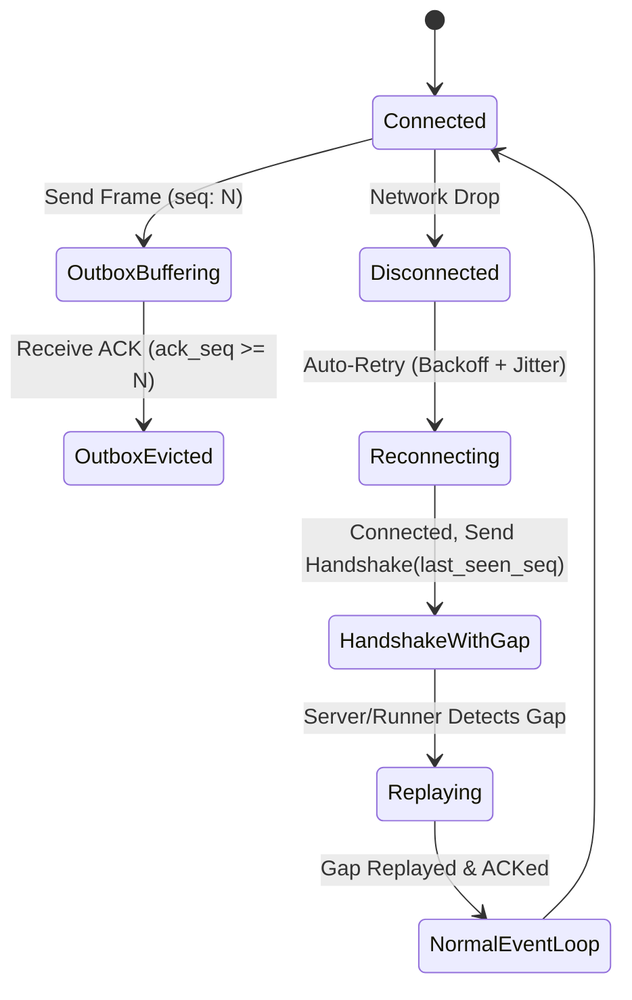

# AgentHub 多路复用事件总线与同步协议规范 (Sync Protocol v2.0)

> **版本**：2.0.0-spec  
> **更新日期**：2026-09-01  
> **协议地位**：AgentHub Runner 与 Server 之间单长连接多路复用通信的权威二进制/JSON 格式契约。

---

## 1. 协议核心设计与连接模型

1. **单物理连接多路复用**：Runner 节点与云端 Server 之间维持且仅维持**一条 WebSocket 物理长连接**。
2. **统一 Frame Envelope**：所有控制命令（Commands）、业务事件（Events）、流式 Token（Stream Deltas）、状态确认（ACKs）及心跳巡检均封装在标准帧中。
3. **强制 ACK + Replay**：引入基于有序序列号（`seq`）与滑动窗口的双向确认和断线自动重放协议，确保零丢失。
4. **版本协商（Version Negotiation）**：连接握手阶段显式协商协议版本与能力集，向后兼容。

---

## 2. 帧封装结构（Frame Envelope）

所有帧均为 UTF-8 编码的 JSON 对象（二进制传输模式预留），通用结构如下：

```typescript
export interface FrameEnvelope<T = any> {
  /** 协议大版本号，当前为 2 */
  ver: 2;
  /** 帧唯一 ID (UUID v4 或 ULID) */
  frame_id: string;
  /** 帧类型 */
  type: 
    | "handshake"
    | "handshake_ack"
    | "heartbeat"
    | "heartbeat_ack"
    | "event"
    | "cmd"
    | "cmd_ack"
    | "ack"
    | "reconcile_check"
    | "reconcile_sync"
    | "presence";
  /** 发送方递增的全局序列号 (1, 2, 3...) */
  seq: number;
  /** 发送方当前已确认接收到的对方最大连续序列号 */
  ack_seq: number;
  /** 多路复用会话包装 ID (Runner 级帧此字段为 null) */
  hub_session_id?: string | null;
  /** 客户端发起的幂等命令追踪 ID (仅在 cmd / cmd_ack / 关联 event 中出现) */
  cmd_id?: string | null;
  /** 发送时间戳 (Unix 毫秒) */
  timestamp: number;
  /** 具体业务负载 */
  payload: T;
}
```

---

## 3. 连接握手与版本协商机制 (Handshake)

### 3.1 握手请求 (`handshake`)

Runner 连接建立后必须发送的第一帧：

```json
{
  "ver": 2,
  "frame_id": "frm_01J8A001",
  "type": "handshake",
  "seq": 1,
  "ack_seq": 0,
  "timestamp": 1725148800000,
  "payload": {
    "runner_id": "run_01J6XYZ...",
    "client_version": "2.0.0",
    "min_supported_protocol": 1,
    "max_supported_protocol": 2,
    "last_seen_server_seq": 450,
    "capabilities": {
      "providers": ["claude_code", "codex_app_server"],
      "supports_stream_compression": true,
      "max_replay_window": 2000
    }
  }
}
```

### 3.2 握手确认 (`handshake_ack`)

Server 验证后应答：

```json
{
  "ver": 2,
  "frame_id": "frm_01J8A002",
  "type": "handshake_ack",
  "seq": 1,
  "ack_seq": 1,
  "timestamp": 1725148800050,
  "payload": {
    "status": "accepted",
    "negotiated_protocol": 2,
    "server_version": "2.0.0",
    "last_seen_runner_seq": 1024,
    "replay_from_seq": 451,
    "active_hub_sessions": ["hub_sess_01", "hub_sess_02"]
  }
}
```

若 `replay_from_seq` 小于 Server 当前最新序列号，Server 立即启动滑动窗口重放逻辑。

---

## 4. 可靠传输与滑动窗口重放协议 (ACK + Replay)



### 4.1 确认与重放规则
1. **累计确认（Cumulative ACK）**：`ack_seq = N` 表示接收方已完整无误接收到序列号 `<= N` 的所有帧。
2. **滑动窗口缓冲（Outbox Buffer）**：双方均在内存及本地磁盘（SQLite/WAL）中保留最近 2000 个未被对方 ACK 的帧。
3. **断线重放（Replay Trigger）**：
   - 握手阶段比对双方 `last_seen_seq`。
   - 若发送方最新序列号大于对方 `last_seen_seq`，按顺序重放差额帧（Frame 中的 `is_replay: true` 标记可选置位）。
   - 接收方根据 `seq` 严格去重，确保数据流绝无重复与遗漏。

---

## 5. 控制命令集 (Commands) 与幂等处理

所有控制命令均通过 `type: "cmd"` 发送，且强制携带 `cmd_id`。

### 5.1 启动会话 (`launch_session`)

```json
{
  "ver": 2,
  "frame_id": "frm_01J8B001",
  "type": "cmd",
  "seq": 1025,
  "ack_seq": 451,
  "hub_session_id": "hub_sess_999",
  "cmd_id": "cmd_create_001",
  "timestamp": 1725148805000,
  "payload": {
    "action": "launch_session",
    "launch_profile": {
      "workspace_path": "d:/ClaudeSpace/Project/solum",
      "provider": "claude_code",
      "model": {
        "model_id": "claude-3-7-sonnet-20250219",
        "reasoning": { "effort_level": "high", "budget_tokens": 16000 }
      },
      "permissions": { "approval_mode": "ask_all_edits" }
    }
  }
}
```

### 5.2 提交用户 Prompt (`send_prompt`)

```json
{
  "ver": 2,
  "frame_id": "frm_01J8B002",
  "type": "cmd",
  "seq": 1026,
  "ack_seq": 451,
  "hub_session_id": "hub_sess_999",
  "cmd_id": "cmd_prompt_002",
  "timestamp": 1725148810000,
  "payload": {
    "action": "send_prompt",
    "text": "优化 WebSocket 帧的序列化开销",
    "client_turn_id": "turn_1"
  }
}
```

### 5.3 审批工具执行 (`resolve_approval`)

```json
{
  "ver": 2,
  "frame_id": "frm_01J8B003",
  "type": "cmd",
  "seq": 1027,
  "ack_seq": 451,
  "hub_session_id": "hub_sess_999",
  "cmd_id": "cmd_appr_003",
  "timestamp": 1725148815000,
  "payload": {
    "action": "resolve_approval",
    "approval_id": "appr_01J8...",
    "decision": "approved", // "approved" | "rejected"
    "custom_feedback": ""
  }
}
```

### 5.4 中断执行 (`interrupt_turn`)

```json
{
  "ver": 2,
  "frame_id": "frm_01J8B004",
  "type": "cmd",
  "seq": 1028,
  "ack_seq": 451,
  "hub_session_id": "hub_sess_999",
  "cmd_id": "cmd_stop_004",
  "timestamp": 1725148820000,
  "payload": {
    "action": "interrupt_turn",
    "reason": "user_cancelled"
  }
}
```

### 5.5 导入本地原生会话 (`import_native_session`)

```json
{
  "ver": 2,
  "frame_id": "frm_01J8B005",
  "type": "cmd",
  "seq": 1029,
  "ack_seq": 451,
  "hub_session_id": "hub_sess_import_001",
  "cmd_id": "cmd_import_005",
  "timestamp": 1725148825000,
  "payload": {
    "action": "import_native_session",
    "provider": "claude_code",
    "native_session_id": "d0f8a8b1-...",
    "workspace_path": "d:/ClaudeSpace/Project/solum"
  }
}
```

---

## 6. 事件集 (Events) 与流式输出优化

所有 Agent 状态变化与内容输出均通过 `type: "event"` 由 Runner 上报。

### 6.1 高频流式分块 (`stream_delta`)

为了平衡 60fps 实时流畅度与网络 I/O 开销，Runner 将 50ms 窗口内的 Token 聚合为一个 Delta 帧：

```json
{
  "ver": 2,
  "frame_id": "frm_01J8E001",
  "type": "event",
  "seq": 2048,
  "ack_seq": 1029,
  "hub_session_id": "hub_sess_999",
  "timestamp": 1725148830000,
  "payload": {
    "event_type": "stream_delta",
    "turn_id": "turn_1",
    "block_index": 0,
    "delta_type": "text | thinking | tool_input",
    "delta_content": "正在对网络帧做性能分析..."
  }
}
```

### 6.2 状态流转事件 (`session_state_changed`)

```json
{
  "ver": 2,
  "frame_id": "frm_01J8E002",
  "type": "event",
  "seq": 2049,
  "ack_seq": 1029,
  "hub_session_id": "hub_sess_999",
  "timestamp": 1725148831000,
  "payload": {
    "event_type": "session_state_changed",
    "previous_state": "running",
    "current_state": "awaiting_permission",
    "reason": {
      "waiting_for": "tool_approval",
      "approval_id": "appr_01J8...",
      "tool_name": "Bash",
      "tool_params": { "command": "git commit -m 'feat: sync'" }
    }
  }
}
```

---

## 7. 状态校验巡检协议 (Reconcile Protocol)

Runner 默认每 30 秒向 Server 发送 `reconcile_check` 帧，比对活跃会话状态摘要：

```json
{
  "ver": 2,
  "frame_id": "frm_01J8R001",
  "type": "reconcile_check",
  "seq": 2100,
  "ack_seq": 1035,
  "timestamp": 1725148860000,
  "payload": {
    "runner_id": "run_01J6XYZ...",
    "sessions_digest": [
      {
        "hub_session_id": "hub_sess_999",
        "execution_state": "idle",
        "current_turn": 3,
        "state_fingerprint": "e3b0c44298fc1c149afbf4c8996fb92427ae41e4649b934ca495991b7852b855"
      }
    ]
  }
}
```

若 Server 检测到状态指纹不匹配，返回 `reconcile_sync` 帧要求全量校准对应会话的最新快照。
